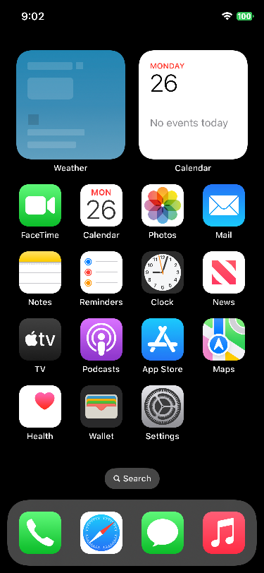

# OnePlus 9 日常 base · 默认 120 Hz

本文记录维护者本机包的功能与验收证据。新用户请看 [复现指南](LEMONADE-REPRODUCE.md)：发布方负责实机验收，用户只准备本机必要文件与指定 Apple 系统。现有本机包及其验收记录不能直接用于另一台手机；普通用户准备工具与已验收公开运行版本尚未交付。

`main` 已集成异步 Metal、双缓冲多层显示、退出排空、Safari 刷新策略，以及默认启用的真实电量、充电状态、原生蓝牙发现和 Sileo 修复。双缓冲原生场景实测约 116–117 fps，详见 [原生多层显示修复](LEMONADE-NATIVE-BENCH.md)。电池单独实测与 USB 重连限制见 [电池驱动](LEMONADE-BATTERY.md)；当前组合的完整运行包验收已通过，见下文 `2026.10.27-base.2`。

驱动设计、问题清单和源码入口见 [图形与显示驱动](LEMONADE-DISPLAY.md)、
[面板切换](LEMONADE-120HZ.md) 与 [Wi-Fi 驱动](WIFI-LEMONADE.md)。

最近完成整套运行包验收的是 `2026.10.27-base.2`，包含双缓冲显示、Wi-Fi、电池、Sileo 和原生蓝牙发现。GPU 为 379 MHz；本版未重新测量 UFO Test，不以面板 120 Hz 代替网页实际帧率。
双击包内 `Start.command` 即使用 120 Hz，不需要补充启动参数。旧的
`2026.10.24-base.1` 目录、ZIP 和源码标签保持不变，可用于 60 Hz 回退。

## 原绑定设备使用

本机运行包：`out/releases/lemonade-2026.10.27-base.2/`，压缩包为同名 `.zip`。
运行包和源码版本分开管理；对应实现合入两个仓库的 `main`，原运行包与既有标签均保留。
将此包绑定的 LE2110 通过 USB 接入安装了 Python 3.11+、adb、fastboot 的 Mac，运行
`Start.command`；返回 Android 使用 `Return-to-Android.command`。

默认参数包含 `lemonade_display_hz=120` 和 `lemonade_panel=655`，并启用 DPU 直接显示、
生产者释放同步。`ca_vbl=0` 让 Core Animation 使用原生 CADisplayTimer；DPU 的 TE 同步和
GPU fence 检查仍然启用。现有本机启动器在启动前校验设备身份、文件哈希、面板绑定、维护者已完成的对应内核 DMA
保护测试，以及 120 Hz 与 GPU／触控／Wi-Fi／电池／蓝牙联合验收、原生蓝牙设备列表记录；不在每次启动时重跑验收。面板切换后先测量 64 个 TE
周期，成功后才向 iOS 发布 120 Hz 模式。

运行包包含 Adreno 660 GLES/Metal、SpringBoard、小组件所需服务、实体触控和 QCA6490
Wi-Fi、原生蓝牙与电池服务。`/redwood/bin` 只包含 `metal-enable` 和板级蓝牙 bootstrap；没有测试应用、网络测试程序、自动手势、
开机自检、详细性能采样或定时退出。网络密码和既有账号没有打入包内。

系统从 RAM 运行，重启后设置与会话不保留。它不是完整 Android 替代 ROM。120 Hz 是
固定启动模式，应用实际帧率受自身配置和负载影响；自适应刷新率、长期温控与续航、睡眠唤醒
和其余外设仍待后续验证。原生设置中首次输入 Wi-Fi 密码的完整流程也尚未单独验收。

## 2026.10.27-base.2 蓝牙集成版

基于前一版完整 base 加入原生蓝牙 H4 控制器、固件启动服务与原生主机兼容。
内核 SHA-256：`22206252397d69c037632b7ef695ead42c4e64a790210f0b624a30cd1e96dd6a`；root：`b8b686fbf49b51167826a36b4856e4d07bc6aa5d0d9b10811b4390c4df4e0929`。
对应用户态提交固定在 `devices/oneplus-9/sources.json`。正式包不包含蓝牙测试客户端、追踪库、UI 观察器或自动设置页面启动。

- 当前内核重新通过真实 DMA 防护；180 秒联合验收覆盖显示 36 项、网络 61 项、Metal 103 项、MPS 2 项、Core Animation 4 项，完成 2773 次 DPU 传输，零回退和失败。
- Wi-Fi 验证关联、DHCP、DNS、三次 HTTP 请求和受控重连；蓝牙保持真实已开启/可用状态，14 次采样全部通过；电池有 13 个日志样本和 10 次不同更新的原生接口对照。
- 另一次从 Android 冷启动的 180 秒测试，在 Wi-Fi station、图形和电池均启用时，原生 `BTSDevicesController` 显示 1 个真实设备，收到 1 次原生发现通知；画面读回确认附近 Mac，蓝牙服务没有重启。
- 未增加诊断负载的正式包持续运行 90 秒后由主机主动停止，通过 28 项检查，完成 743 次 DPU 传输；蓝牙传输、UART/时钟、Wi-Fi DMA、显示及 GPU 均正常停止。

一次复用已返回的 RAM 加载器的测试在 Wi-Fi 初始化期间进入 Qualcomm `05c6:900e`，当时还未观察到蓝牙启动。底层根因仍未隔离；启动器现会先返回 Android，再重新冷启动，恢复原 Android 蓝牙设置。软件重启后已核对 Android 与五个分区哈希，失败记录保留，不作为通过证据。

最后再次返回原 Android，原槽位、蓝牙设置和五个关键分区哈希均核对通过。证据在 `local/lemonade/release-2026.10.27-base.2/` 与 `local/lemonade/base-bluetooth-20261027/`。蓝牙配对、音频、外设数据、反复开关、睡眠唤醒和长期稳定性仍未验收。

## 2026.10.26-base.2 联合体验版（历史）

本机新包包含当前 Wi-Fi、图形/触控、双缓冲显示、电量和 Sileo 修复。对应 kernel 为
`5fecc557d6d445e5050d17eb569e3a9c1e117a153eae56d27bbac6e4663904b9`，root 为 `76a8bd250cd35641dabb916047eac98f74d14909ca5293e011a544b696cfcfa1`。
正式包没有测试程序、自动手势、录制或定时退出；Sileo 由正常启动服务准备并注册。

该组合先完成对应内核的 DMA 防护检查，再通过显示 36 项、网络 61 项、Metal 103 项、
MPS 2 项、Core Animation 4 项，完成 1903 次显示传输。Wi-Fi 覆盖关联、DHCP、DNS、
三次 HTTP 请求和断线重连。电池取得 7 个不同日志样本与 10 次不同更新的原生对照；
内核、IORegistry、IOPS 和电源列表均为 100%，接电、满电标志一致，无过期或采样错误。
验收脚本现在核对实际原生接口，不再依赖可能未保留在日志环中的 IOKit 注册消息。

正式运行包随后持续运行 90 秒，直到主机主动停止，共通过 25 项检查，
完成 772 次显示传输；Sileo 自动注册、电池持续更新、正常排空与退出均通过。
之后已返回原 Android，核对原槽位和五个关键分区哈希。证据位于
`local/lemonade/release-2026.10.26-base.2/`，组合验收与正式包运行分别记录。



图像来自联合验收期间已完成显示传输的源表面，非光学拍摄。原生首次输入 Wi-Fi 密码、
物理 USB 拔插后的电源切换、未满电实际充电和长期稳定性仍未完成验收。
Sileo 的图形化安装与 NewTerm 命令验证使用独立镜像，详情见 [Sileo 修复](LEMONADE-SILEO.md)。

## base.4 Safari 网页刷新策略（历史，2026-10-25）

原手机现场日志覆盖 60.160 秒，实际提交 **60.006 fps**，同时面板模式始终为 120 Hz。
所以用户看到的 UFO Test 60 fps 不是误报，原生界面达到 120 fps 也不能证明网页达到该速度。
本机 Safari 版本为 `8615.2.9.10.3`，缓存中的 WebKit 为 `615.2.9.10.3`。
Safari 的 `PreferPageRenderingUpdatesNear60FPSEnabled` 默认开启；真机读取的最大显示间隔为
8.333 ms，但 WKDisplayLinkHandler 请求 60 fps。关闭这一原生选项后请求变为 120 fps。
[WebKit 的相关说明](https://bugs.webkit.org/show_bug.cgi?id=290671)也区分了网页更新策略与显示能力。

正式修正仅加载进 MobileSafari，并且要求 RAM 运行、明确请求 120 Hz、驱动实测 120 Hz。
首次创建网页视图时，通过 Safari 自己的键名映射写入真实偏好设置，关闭“优先 60 fps”，
用标记避免再次覆盖用户选择。随后按当前偏好配置网页；没有覆盖 JavaScript 时钟、RAF
回调、帧率报告值或 CADisplayLink 的最大值。真机通过偏好值 0 → 1 → 0 创建网页视图，
三个实际读取值均匹配，证明后来选择 60 fps 不会被再次强制取消。此项验证使用原生偏好 API，
未声称人工点击过设置界面的开关。

| 同一 UFO Test 页面 | 原生网页回调平均 | 最后约 40 秒的 DPU 完成 | 面板模式 |
| --- | ---: | ---: | ---: |
| 原始 60 fps 策略 | 60.000 fps / 67.650 s | 60.003 fps | 120 Hz |
| 临时关闭选项的对照 | 106.322 fps / 67.700 s | 102.881 fps | 120 Hz |
| 正式 base.4 修正，含观测探针 | 96.834 fps / 72.072 s | 94.398 fps | 120 Hz |
| 正式修正库直接加载，无网页观测探针 | 未注入 RAF 观测 | 105.272 fps | 120 Hz |

带观测探针时 UFO 标签为 106 fps，对照版本中为 114 fps；正式库直接加载且无网页观测探针时，UFO 标签显示 120 fps。
这个标签不能证明每一帧都完成显示：后者的实际完成平均为 105.272 fps。这些画面读数不替代全段平均值。
正式版回调间隔 P50 为 9 ms，P95 为 17 ms，最大 37 ms，所有长帧均保留。
**固定 60 fps 策略已经解除，但本页面仍有掉帧，未达到稳定 120 fps。**
网页绘制与合成性能仍需进一步定位，不能用请求值 120 或原生设置的帧率替代网页的实际结果。
测试探针只观察该测试站的原生 RAF 回调；截图来自 DPU 完成后的源表面，非光学拍摄。

base.4 root SHA-256：`b7651d2dd4b3da38741bcbfd651959c6cd74bae541ab4225dc0b32f327be1c51`。
相对 base.3，仅改变 `etc/inject.conf`、`etc/motd` 并增加 Safari 修正库；内核、System、
加载器和 Metal 二进制完全相同。新 root 联合检查通过显示 36 项、网络 61 项、Metal 103 项、
MPS 2 项与 Core Animation 4 项，共 1893 次 DPU 完成。正式包无探针运行 90 秒通过
23 项检查，三个定时退出和一次主动退出均未观察到 SIGSEGV。原 Android 槽位与五个关键分区哈希核对通过。
base.3 下文的多层、设置滚动与六次退出证据仍属于其原始 root，没有改写成 base.4 的测试。

私有证据：`local/lemonade/ufo-120hz-20261025/`，正式策略测试 `113418-production`，无网页观测探针测试 `114316-direct-safari`；
联合与干净运行证据位于 `local/lemonade/release-2026.10.25-base.4/`。正式运行包不包含
探针、测试网页脚本、录制、自动手势、定时退出、网络密码或既有账号。

## base.3 多层显示与退出修复（历史，2026-10-25）

最终内核 SHA-256：`859a87e4b23731c16ccfdbba5e6882b4f8e42b9bbe1515ddea6cd95e40f74a94`。正式 root：
`d5dfe5c404363412efa3a818c3b05f7ea1ea7941990569a2352fec8c5179addd`。以下 base.3 验收均绑定这两个哈希。

此前只有底层全屏表面能够直接显示，第二层会进入恢复固件 60 Hz 的 CPU 拷贝路径。
现在最多四个非平面 BGRA32 图层先在逻辑分辨率 1125×2436 的自有表面上完成预乘透明度
叠加、裁切与缩放，再交给同一个 DPU 路径。生产者 GPU fence、DPU 实际完成和解除映射仍
是释放源表面的前提；合成缓冲区在传输完成后才可复用。录制也读取合成后的表面。
底层完整覆盖时省去重复清屏，避免额外写入 11 MB 后错过 TE；没有完整底层时仍清除未覆盖区。

强制真机测试 `102428-multilayer`：两层、四层、单层各持续四秒，测试表面带有每帧变化的色块，
桌面仍独立运行并提交约 10 帧/秒。开启源图录制时的实际完成统计如下；没有剔除长帧：

| 图层数 | 测试程序完成 / fps | 含桌面的总显示 fps | 总帧间隔 P95 | 合成耗时中位数 |
| --- | ---: | ---: | ---: | ---: |
| 2 | 445 / 111.068 | 121.106 | 8.306 ms | 1.192 ms |
| 4 | 445 / 111.117 | 121.103 | 8.305 ms | 1.439 ms |
| 1 | 445 / 111.116 | 121.104 | 8.309 ms | 无额外合成 |

总显示率包含后台桌面帧；测试程序自身的帧率见第二列。三段最大帧间隔均小于 8.35 ms。
面板保持实测通过的 120 Hz 模式，回退、呈现失败和退出残留映射均为零。每段有 367 帧通过
五个像素位置的 RGB 核对，覆盖透明红色、蓝色交叠、绿色裁切缩放以及移除图层后的背景。
这些是 DPU 完成后仍持有的源表面读回，未声称光学拍摄或测得光子发出时刻。
新增合成当前支持非平面 BGRA32；其他像素格式仍可能走旧兼容路径。

退出异常的实际调用链为：GPU 已关闭，backboardd 继续申请 BO，Mesa 的
`fd6_build_bindless_state` 将失败得到的空指针传给 `fd_bo_mark_for_dump`。
新顺序先关闭终止会话的用户 GPU 调用入口，等已进入的调用排空，再排空显示队列，最后
关闭 GPU。后来到达的调用等待本次 RAM 内核返回，不向仍在渲染的 Mesa 返回半关闭设备
的分配失败。内部 GPU 完成查询继续可用；调用排空超时时保留 GPU 到最终停机处理，
显示排空超时则保留源表面与未完成 fence，不制造完成状态。

最终内核完成 **3 次定时退出、3 次主动退出**，包含原生设置持续滚动中退出。
六轮均验证调用排空、显示排空、GPU 关闭的顺序与正常返回，未观察到 SIGSEGV。
实际日志还记录了退出期间抵达并等待的 GPU 调用。验收器现在将缺少排空、顺序错误和
SIGSEGV 判为失败。正式包 90 秒干净运行通过 23 项检查，直到主机主动停止。

原生设置完整复测 `102552-120hz`：慢滑 **119.19 fps**，快滑 **119.86 fps**，快速帧间隔
P95 **8.322 ms**；两段各 24 秒，提交编号连续、无漏样。慢滑开始约 0.18 秒处有
115.645 ms 的长间隔，已计入统计；该轮没有走多层合成。快滑最大 16.591 ms。
设置应用与 Info.plist 未改动，输入作业使用 Interactive 类型，未将请求刷新率替代实际输出测量。

最终联合运行 `1792895019`：显示 36/36、联网 61/61、Metal 103/103、MPS 2/2、
Core Animation 4/4，1883 次 DPU 完成且零回退。独立 DMA 防护检查也绑定最终内核。
主机直接执行生产实现的 6 组合成检查（含 50,000 个透明度参考像素）、4 组并发排空检查、
11 组显示 fence 检查、10 项证据反例和 10 项 base 检查通过；合成与并发测试启用 ASan/UBSan。
最后返回 Android，核对 USB 身份、原槽位和五个关键分区哈希均未改变。

本次私有证据位于 `local/lemonade/multilayer-exit-20261025/` 与
`local/lemonade/release-2026.10.25-base.3/`。最初未优化的多层测试与中间候选另行保留，
不作为最终性能记录。对应功能修复已整理进入 `main`；旧发布包保留。

## base.2 原生设置滚动实测与修复（历史，2026-10-25）

此前 Refresh 测试应用的 120 fps 只证明显示通路能力，不能代表原生设置。
初次自动滚动的 46–67 fps 结果还混入了测试程序自身的问题：launchd 作业缺少
`ProcessType=Interactive`，后台计时器将目标 8 ms 的输入合并为最长约 100 ms 的等待，
随后集中补发触控。因此撤回用那组数字描述原生设置实际性能或推断硬件垂直同步故障的结论。
原始运行 `070040-120hz`、`070242-60hz`、`070443-120hz` 保留作问题追溯，不作为验收基线。

修正作业类型后，每段 24 秒有完整的 3000 个移动样本，平均间隔 8.000 ms、P95 约
9.5 ms、最大约 10 ms，未发生输入突发。设置应用与 Info.plist 均未改动。
同样的慢速（单程 800 ms）和快速（单程 400 ms）往返，显示完成时间实测如下：

| Metal 提交方式 / GPU 频率 | 慢速往返 | 快速往返 | 快速帧间隔 P95 |
| --- | ---: | ---: | ---: |
| 原同步等待 / 315 MHz | 86.47 fps | 83.94 fps | 16.57 ms |
| 原同步等待 / 540 MHz | 109.83 fps | 104.52 fps | 16.54 ms |
| 异步完成 / 315 MHz | 116.96 fps | 116.91 fps | 8.33 ms |
| 异步完成 / 379 MHz | 117.59 fps | 118.74 fps | 8.32 ms |
| 异步完成 / 443 MHz | 117.44 fps | 118.50 fps | 8.33 ms |

根因是 Metal `commit` 在持有 Mesa 上下文锁时同步等待整批 GPU 工作完成，CPU 无法
及时准备下一帧。提高 GPU 频率只能缓解；把提交和真实 fence 完成等待分开后，在原频率
下即可恢复大部分帧。同步版本中关闭 `ca_vbl` 没有改善；完成异步修复后，该时钟选择才
成为剩余约 2 fps 差距的主要因素，不能把同步版本的结论直接套用到异步版本。

修复仍在调用线程内编码并提交，确保 IOSurface 的 GPU fence 在 Core Animation 交帧前
已经登记；独立完成队列等待 fence，然后发布完成状态、回调和归还队列名额。资源在此期间
保持所有权，显示驱动仍检查实际 GPU 完成，不提前声明画完、不绕过显示释放保护。

统计保留长帧，未删除首轮进入滚动时的单次长间隔。379 MHz 运行的一秒源图采集及其前后
一秒不计入帧率；它确认画面为原生设置列表，属于完成传输后的 IOSurface 源图，非光学拍摄。
上述整段显示提交编号连续，没有漏样。当前表格记录对照试验，最终候选与持续运行验收另列。

本机绑定哈希的原始日志和分析位于 `local/lemonade/settings-refresh-20261025/`，依次为
`082025-120hz`、`081338-120hz`、`082322-120hz`、`082544-120hz`、`082754-120hz`。

正式候选（新内核、相同修复库）的独立短段对照还包括：运行中不读取 USB 日志、不开源图
采集的 12 秒快滚，120 Hz 为 **117.93 fps / P95 8.327 ms**，60 Hz 为
**57.83 fps / P95 16.606 ms**，两轮提交编号均连续。这些是整段实际输出，仍包含短暂长帧。
恢复原生帧时钟后的完整复测（`085246-120hz`）采用同样两段 24 秒连续触控：慢滑
**119.64 fps / P95 8.320 ms**，快滑 **119.87 fps / P95 8.328 ms**，分别有 98.99% 和
99.10% 的帧间隔小于 10 ms。两段提交编号连续，无漏样或未匹配提交；统计仍保留长帧，
慢滑最大 33.050 ms，快滑最大 16.625 ms。完整五秒硬件窗口为 119.75–120.16 fps。

`ca_vbl=1` 会向 backboardd 注入 `CA_FORCE_TIMER`，强制 QuartzCore 使用驱动刷新通知。
本移植使用的 iPhone X 用户空间原本走 CADisplayTimer；移除这项强制后，系统读取的模式
仍为 120 Hz，实际帧输出改善。这里没有关闭物理垂直同步，也没有把刷新率标志当成帧率。
不宣称每一帧都严格锁在 8.33 ms 内。

最终内核（包含退出排空与兼容路径刷新率恢复）的复测 `093119-120hz`：慢滑
**119.34 fps / P95 8.308 ms**，快滑 **119.96 fps / P95 8.313 ms**。两段各 24 秒，
分别完成 2866、2877 帧，编号连续、无漏样；两段各 3000 个触控移动，平均间隔 8.000 ms，
最大不足 10 ms，无集中补发。统计保留慢滑的 33.055 ms 最大长帧；快滑最大 16.603 ms。

四分钟连续快滑复测（`085557-120hz`，加入下述两个内核修复之前、相同图形运行库）
不读取运行中的 USB 日志，不采集屏幕，也关闭逐帧
触控与 CPU 采样。中间 47 个完整五秒显示窗口，共 235.089 秒，平均 **119.44 fps**，
窗口范围 117.96–120.17 fps；28,078 次窗口内显示中 28,067 次硬件输出签名变化。窗口选择
排除了进入与结束的非完整滚动部分，没有删除窗口内的长帧。整轮 29,045 次显示提交完成，
失败、回退和退出残留映射均为零，没有 SIGSEGV。原强制时钟的同样四分钟试验为 118.21 fps。
这证明本次持续滚动的改善，不替代整日温控、续航或其他应用的验证。

## base.2 联合回归

新内核先完成独立 DMA 故障保护验证，再在临时副本中联合运行 GPU、显示、触控与网络负载。
运行 `1792888826` 的显示检查 34/34、联网检查 61/61 通过；Metal 功能 103/103、MPS 2/2、
Core Animation 4/4 通过。新增 GPU 用例验证提交提前返回、回调顺序，以及完成回调中的真实
计算结果读回。1931 次显示提交全部完成，回退、失败、退出残留映射均为零。
主机另用 90 个受控 fence 验证提前释放、部分编码错误、GPU 错误、等待线程与名额归还。

切换到原生帧时钟后的联合运行 `1792890407` 暴露了既有退出顺序问题：定时退出先关闭
GPU，显示队列仍有两帧未处理，产生缺失 GPU 完成与退休顺序错误；该轮没有通过显示验收，
失败记录保留。Metal 103/103、MPS 2/2、Core Animation 4/4 与联网 61/61 当轮均通过。

随后补上显示排空：GPU 停止之前关闭新帧入口，唤醒阻塞的提交者，并等待已经接收的帧真正
完成；最多等待两秒，超时仍保留源表面与未完成 fence，不伪造退休。主机直接运行生产代码的
11 组场景通过 ASan/UBSan，其中包含排空、阻塞提交唤醒与超时保持；9 项日志证据测试还会
拒绝缺失、失败或发生在 GPU 关闭之后的排空记录。原有的退出期间 backboardd 清理异常
需要按最终真机日志另行判断，不能仅凭帧队列修复宣称全部进程退出问题都已解决。

运行 `1792890959` 已验证显示队列先排空、GPU 后停止，但多层画面触发了兼容 CPU 路径，
当轮显示验收仍失败。另一个根因是：兼容路径恢复固件 60 Hz 后，直接显示重新接管时没有
恢复请求的 120 Hz。修复后重新接管会再次核对面板、测量 TE，成功才发布 120 Hz；相关
主机测试覆盖成功恢复、显式 60 Hz、映射失败、面板失败与停止中断。兼容 CPU 路径本身
仍为 60 Hz，不能将多层画面也描述为持续 120 fps。原严格无回退验收条件未修改。

最终内核运行 `1792891818` 通过原严格验收：显示 35/35、联网 61/61，Metal 103/103、
MPS 2/2、Core Animation 4/4；1967 次直接显示提交完成，无回退、失败或退出残留映射。
日志证明显示队列已排空，然后 GPU 停止。该轮没有触发多层兼容路径，因此恢复分支的新增
覆盖来自主机测试；不把它写成已完成真机强制回退测试。定时压力测试退出之后仍出现既有
backboardd SIGSEGV，内核与显示／网络硬件恢复正常，返回结果为 0。

正式包随后通过包内启动器原样运行 90 秒，11 次观察均保持运行，直到宿主主动停止。
22 项默认配置、无测试任务、持续运行、显示排空与硬件恢复检查通过；736 次显示完成，
无回退、失败和残留映射。主动停止期间同样观察到一次 backboardd SIGSEGV，已在证据
单列 `userspace_exit_sigsegv=1`，不能将 22 项检查通过描述成全部用户进程无异常退出。
最终内核测试后于 09:37 返回 Android，USB 身份、完整启动和五个关键分区哈希均核对通过；
证据为 `android-roundtrip-20261025T093737.json`。

## 构建与验收

两个源码仓库使用 `main`；具体配对提交和 base 标签见
[`lemonade.sources.json`](../devices/oneplus-9/sources.json)。既有环境中的构建步骤：

```sh
# 在配置好 THEOS 的构建容器中
devices/oneplus-9/tools/lemonade-build-kernel.sh
AIR=1 bash tools/mk-mesa.sh
bash devices/oneplus-9/tools/lemonade-build-metal.sh
bash devices/oneplus-9/tools/lemonade-build-base-runtime.sh
bash devices/oneplus-9/tools/lemonade-build-bt-bootstrap.sh
bash devices/oneplus-9/tools/lemonade-build-bt-compat.sh
bash devices/oneplus-9/tools/lemonade-build-bt-client.sh
bash devices/oneplus-9/tools/lemonade-build-bt-ui-trace.sh
bash devices/oneplus-9/tools/lemonade-build-battery-test.sh

# 宿主：先持有该手机的 Device Hub 租约，核对 Android USB 目标与面板
python3 devices/oneplus-9/tools/lemonade-usb.py panel
python3 devices/oneplus-9/tools/test-lemonade-base.py
python3 devices/oneplus-9/tools/test-lemonade-metal-lifetime.py
python3 devices/oneplus-9/tools/test-lemonade-metal-completion.py
python3 devices/oneplus-9/tools/test-lemonade-display-fences.py
python3 devices/oneplus-9/tools/test-lemonade-display-composite.py
python3 devices/oneplus-9/tools/test-lemonade-display-pipeline.py
python3 devices/oneplus-9/tools/test-lemonade-gpu-return.py
python3 devices/oneplus-9/tools/test-lemonade-display-resume.py
python3 devices/oneplus-9/tools/test-lemonade-check-direct.py
# 选择尚未存在的新版本；以下名称仅为模板。
BASE_CANDIDATE='2026.10.27-base.3-candidate.1'
python3 devices/oneplus-9/tools/lemonade-build-base.py --version "$BASE_CANDIDATE"
python3 devices/oneplus-9/tools/lemonade-validate-base.py --version "$BASE_CANDIDATE"
python3 "out/releases/lemonade-$BASE_CANDIDATE/launch.py" android
python3 devices/oneplus-9/tools/lemonade-validate-base-bluetooth.py --version "$BASE_CANDIDATE"
python3 devices/oneplus-9/tools/lemonade-validate-base-runtime.py --version "$BASE_CANDIDATE"
python3 "out/releases/lemonade-$BASE_CANDIDATE/launch.py" android
python3 devices/oneplus-9/tools/lemonade-verify-android.py
```

构建与验收工具当前默认版本为 `2026.10.27-base.2`；构建器拒绝覆盖已有版本目录。
为当前源码生成新候选时，必须向构建器和三个验收器传入相同且尚未使用的 `--version`。联合验收使用一次性副本
加入图形、网络、电池和蓝牙负载，正式 `root.apfs` 不变。验证结束删除临时网络输入；留存日志先脱敏。
随后使用包内启动器原样运行干净镜像，确认默认模式、持续运行及主动退出恢复。
最后返回 Android，运行 `devices/oneplus-9/tools/lemonade-verify-android.py` 核对五个关键分区哈希。

## base.1 历史证据范围

2026-10-25 联合运行日志 `1792859309`：对应内核的真实 DMA 保护检查通过；面板 64 个 TE
周期实测 **121.248 Hz**，整个运行中的显示窗口均保持 120 Hz 模式。34 项显示检查、61 项
联网检查通过；Metal 功能 101/101、MPS 2/2、Core Animation 4/4。1292 次显示提交全部完成，
提交与释放记录完整，没有回退、失败或退出残留映射。Wi-Fi 完成关联、DHCP、DNS、三次 HTTP、
断线重连及另三次 HTTP。退出时面板恢复 60 Hz，GOP、SMMU、IRQ 与 Wi-Fi DMA 均恢复。

该轮联合负载定时退出期间仍出现此前已有的 backboardd 进程清理异常，内核完成恢复并返回
加载器；不能将这轮压力测试描述成所有进程生命周期无异常。长期稳定性和停止顺序仍待完善。

正式包随后从 Android 经包内 `launch.py start` 原样启动。面板实测 **121.201 Hz**，系统的
120 Hz 模式解析生效；90 秒内的 11 次观察均保持运行，直到宿主明确请求停止。21 项干净
运行检查全部通过，769 次显示提交完成，无失败、回退或残留映射，未见 backboardd 段错误。
默认启动参数、正式镜像哈希、没有测试任务与定时退出，以及面板和 DMA 的正常退出恢复均已
核对。此处验证模式与默认行为，不将静止桌面的提交频率当成 120 fps 动画测量。

主机验证包括 10 项 base 打包／身份／默认参数检查和 8 项显示证据反例检查；base 测试包含
真实 Wi-Fi 运行入口的 ASan/UBSan 检查。正式运行包按逐文件清单校验并压缩，原 60 Hz 包
继续保留。

UIKit 120 fps 和实际变化画面的持续输出证据见 [iOS 120 Hz 验收](LEMONADE-IOS-120HZ.md)。
各版本的联合运行和默认启动证据保存在本机 `local/lemonade/release-<version>/`；Android 回归记录在 `local/lemonade/android-roundtrip-*.json`，不将原始日志、Apple 镜像、原机固件或设备身份
上传到源码仓库。旧 60 Hz base 的验收记录见 [2026.10.24 基线](LEMONADE-BASE.md)。
