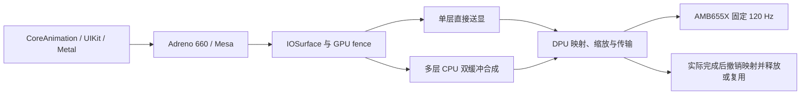

# OnePlus 9 / HackiOS bring-up

本文是维护者的移植、构建和实机验收记录，包含依赖已有本地环境的历史命令。普通用户请看 [复现指南](LEMONADE-REPRODUCE.md)：维护者在发布前编译并验收，用户只准备本机必要文件和指定 Apple 系统，不需要执行本文中的硬件测试。

结构更新（2026-10-27）：内核与用户态已合并为一个仓库，统一使用 `main`；下述早期运行记录涵盖 Adreno 660 GLES/Metal、
DPU 直接显示与双缓冲多层合成、固定 120 Hz、S6SY792 实体触控和 QCA6490 Wi-Fi。
这是本地 LE2110 的 RAM 移植工作记录，尚未完成整机外设、电源管理与长期日用验收。

| 阅读目的 | 对应文档 |
| --- | --- |
| 驱动如何分工、修复了什么、源码在哪里 | [图形与显示驱动](LEMONADE-DISPLAY.md)、[Wi-Fi 驱动](WIFI-LEMONADE.md)、本文末尾的实体触控章节 |
| 面板如何切换并确认 120 Hz | [AMB655X 硬件切换](LEMONADE-120HZ.md)、[iOS 模式与帧时钟](LEMONADE-IOS-120HZ.md) |
| 当前运行包、默认配置与联合验收 | [默认 120 Hz base](LEMONADE-BASE-120HZ.md)；早期 60 Hz 包见 [旧 base](LEMONADE-BASE.md) |
| 多层程序约 60.5 fps 的原因及修复结果 | [原生多层显示修复](LEMONADE-NATIVE-BENCH.md) |
| 两个源码仓库、配套提交与分支约定 | [仓库说明](REPOSITORY.md) |

最新双缓冲设备候选的原生 Metal 场景约 116–117 fps。最近完成整包验收的 **base.4**
已通过显示、Metal、Wi-Fi 联合检查，但尚未包含这次双缓冲流水线；整理后的 `main`
已通过主机回归与构建，不能沿用旧包记录宣称新内核完成整包验收。
Wi-Fi 的实际关联、DHCP、DNS、HTTP 和主动断开重连均有设备证据；长期稳定性、其他认证
方式、睡眠唤醒及所有应用稳定 120 fps 仍未确认。下文保留初期 bring-up 的日期与原始边界。

## 固定源码基线

- [HackiOS kernel](https://github.com/oosexgang/hackios-xnu-kernel): `8e61187098f2c26c5daee8f9f72b6416aa64b9ab`
- [HackiOS userland](https://github.com/oosexgang/hackios-xnu-userland): `906425b75e02b4f99eb5d7bb1ef7c9583472d772`
- [Mu-Silicium](https://github.com/Project-Silicium/Mu-Silicium): `e51cd877e31c8fbb322032dc4cb6715e83d25ad3`，与 `devices/poco-x5-pro/uefi/BASE` 一致。
- 上游入口：[移植说明](https://github.com/oosexgang/hackios-xnu-kernel/blob/main/docs/PORTING.md)。HackiOS 目前公布的是 redwood 和 QEMU 路线；lemonade 需实际移植和设备验证。

## 实机基线（2026-10-22）

| 项目 | 实测 |
|---|---|
| 型号 | OnePlus LE2110 / lemonade |
| SoC | SM8350 / lahaina，SoC ID 415，revision 2.1 |
| 系统 | Android 14，LE2110_14.0.0.730(CN01) |
| 内核 | 5.4.254-qgki-ged93b9ec66ee |
| 启动状态 | B 槽；`flash.locked=0`；`verifiedbootstate=orange`；Magisk root 可用 |
| 内存 | 8 GB 型号；Linux MemTotal 7,439,804 KiB |
| 显示 | 1080 × 2400；Samsung AMB655X DSC；live DT splash base `0xE4D00000` |
| GICv3 | distributor `0x17A00000`，redistributor `0x17A60000` |
| CPU / PSCI | 8 核，MPIDR shift 8；小核 mask `0x0f`；SMC |
| 触控 | Samsung S6SY792，I²C controller `0x990000`，address `0x48`；IRQ GPIO 23，reset GPIO 22 |
| 可用连接 | USB ADB 已验证；stock fastboot `product: lahaina`；loader 使用设备专属 USB 标识 |

`local/lemonade/` 保存设备树、精简基线和启动链备份，权限 0700，整个目录被 Git 忽略。原始 FDT 含运行时身份信息，不能提交或上传。

已备份 A/B 两槽的 `boot`、`vendor_boot`、`dtbo`、`vbmeta`、`vbmeta_system`、`vbmeta_vendor`、`xbl`、`xbl_config`，加上 FDT 共 17 个文件 / 871,221,015 字节。每个文件均与手机端 SHA-256 对照；清单为 `local/lemonade/sha256.json`。这不是 userdata 或完整整机备份。

## 初期启动移植实现

- `devices/oneplus-9/device.conf`：SM8350 的早期启动参数，Android boot header v3。
- `xnuloader/loader.c`：lemonade platform；只有原 redwood 路径允许持久化日志，lemonade 日志留在 RAM/USB。
- `devices/oneplus-9/tools/lemonade-prepare.py`：在固定 Mu-Silicium 基线上应用 XNUP shim/loader 钩子，保留 `0xF0000000..0xF4000000`，禁用 lemonade stage-0 分区日志，去除 live FDT 的 `/chosen` 和 `__symbols__` 后生成启动用 DTB。
- `mkxnuimg.py`：支持 profile 指定 header 版本；拒绝为 lemonade 回退到 redwood 的 shim/UEFI。
- `common/run.sh`：暂时拒绝 lemonade，避免上游 `xl` 的未指定设备命令和 redwood 默认值影响多设备环境。
- `devices/oneplus-9/tools/lemonade-collect.py`：只读采集与按文件哈希校验备份，需要先取得 Device Hub 租约。
- `devices/oneplus-9/tools/lemonade-pack.py`：编译 loader，检查 Android v3 header、shim、lemonade UEFI、脱敏 DTB 和 XNUP 内容；生成 SHA-256 清单。boot 镜像只进入 loader；返回路径自检使用独立 payload。
- `devices/oneplus-9/tools/lemonade-usb.py`：依据已采集的硬件序列号哈希选择 USB 设备，跨重启使用派生的 loader USB 标识；提供临时启动、RAM 镜像上传、定时 XNU/用户空间运行、屏幕读取、诊断、自检和重启。不会选择 Wi-Fi ADB 或列表中的第一台手机。
- USB 路径同时识别 `usb:<path>` 和新 libusb 后端的 `2-1.1` 格式。macOS 沙箱内可能看不到 fastboot，实际设备操作需使用获准的 USB 执行环境；不要把沙箱枚举为空当作线已断开。
- loader 的 USB 状态/屏幕尺寸回复独立于日志缓冲区；USB 模式不把完整内核日志再次挤入 32 KiB loader 日志；`oem log` 保留最后一次完整内核日志。
- `userland/build.sh`：允许预编译产物缺少可选 `drawable_test`；没有 systemd/timedatectl 的构建容器优先使用 `TZ`，否则回落 UTC。

## 已生成的产物（2026-10-23 04:06，Asia/Shanghai）

| 文件 | 大小 | 主机侧验证 |
|---|---:|---|
| `out/lemonade-boot.img` | 2,564,096 B | header v3、实际打包组件逐字节一致、只包含 loader 和 USB 模式 |
| `out/lemonade-selftest.bin` | 15,623,288 B | 上游预编译内核 SHA-256 一致；checkpoint 999，只测试 loader 返回路径 |
| `userland/root.apfs` | 4,194,304 B | apfsck clean；77 个目录项由内核 APFS reader 读回，与源目录一致 |
| `userland/system.apfs` | 2,492,203,008 B | apfsck clean |
| `xnuloader/loader.efi` | 68,608 B | AArch64 EFI 编译通过，含 lemonade platform 和设备专属 USB 标识 |
| `Mu-Silicium/Build/lemonadePkg/RELEASE_CLANGPDB/FV/SILICIUM_UEFI.fd` | 2,097,152 B | lemonade RELEASE 构建成功；48 个 PE 镜像验证通过 |

内核使用上游预编译 Mach-O，已完成 SM8350 单核早期启动及用户空间初测。iOS 16.5 文件由上游 fetch 脚本从 Apple CDN 下载到本地；Apple 文件和设备私有文件均未提交。

清单位于 `out/lemonade-{boot,selftest}.manifest.json` 和 `local/lemonade/{images,validation}.json`。修复诊断缓冲区后的 boot SHA-256 为 `0c83bf17dde85080324b97b5dfe7b7ab507bd65110516a52021a1394b69360f3`；重新构建后以新的 manifest 为准。

## 本地继续构建

工作目录为本仓库。`devices/oneplus-9/tools/lemonade-build.Dockerfile` 提供 Ubuntu 24.04 ARM64 编译环境；本轮实际使用的容器保留为 `hackios-lemonade-env`，源码挂载点为 `/work`，Python 虚拟环境在 `/tmp/hackios-venv`。

```sh
# 修改 lemonade 的 Mu 接入后，重新应用幂等准备脚本：
python3 devices/oneplus-9/tools/lemonade-prepare.py

# 继续本轮保留的环境（容器停止时先启动）：
docker start hackios-lemonade-env
docker exec hackios-lemonade-env bash -lc \
  'export PATH=/tmp/hackios-venv/bin:$PATH; cd Mu-Silicium; python3 build_uefi.py -d lemonade -r RELEASE'

# Mac 上打包；需要 clang、lld-link、llvm-objcopy、dtc：
python3 devices/oneplus-9/tools/lemonade-pack.py
python3 devices/oneplus-9/tools/test-lemonade-usb.py -v

# 已提取 Apple 文件后重建 APFS：
docker exec hackios-lemonade-env bash -lc \
  'TZ=Asia/Shanghai SKIP="kernel loader boot" common/build.sh lemonade'
docker exec hackios-lemonade-env bash -lc \
  'tools/apfs/check-image.sh userland/root.apfs userland/root && xnu-deps/build/apfsprogs/apfsck/apfsck -cw userland/system.apfs'
```

新建环境需从 `devices/poco-x5-pro/uefi/BASE` 指定提交检出 Mu-Silicium，初始化顶层 submodules，安装 `Mu-Silicium/pip-requirements.txt`，并先运行 `lemonade-prepare.py`。`Mu_Basecore` 只初始化实际所需的 Brotli（两个目录）、oniguruma、libfdt、mipisyst，避免拉取未参与此目标构建的 libspdm 单元测试依赖。ARM64 容器中，将 `/usr/bin/{nasm,ndisasm}` 链接到 `Mu_Basecore/BaseTools/Bin/mu_nasm_extdep/Linux-ARM-64/`，`extdep_state.yaml` 设为 `version: 20016.1.1`；随后运行 lemonade `DeviceBuild.py --setup`、`--update` 和 `build_uefi.py`。保留的容器已完成这些步骤。

Mu submodule 的工作树在容器内初始化，部分 `.git` 指向 `/work`；检查它们时使用 `docker exec`，不要因宿主机找不到 `/work` 而重置工作树。

## 验收顺序

1. USB 直连 Mac，核对设备身份哈希和 fastboot product，确认仍为已解锁设备。
2. 运行 `python3 devices/oneplus-9/tools/lemonade-usb.py status`，确认本机 USB；再运行 `python3 devices/oneplus-9/tools/lemonade-usb.py boot`，它在校验 manifest 后使用指定设备的 `fastboot boot` 临时启动。
3. 验证 UEFI/loader 的显示、`product: xnuloader`、USB 日志、GOP 地址、RAM map；保存本地证据。
4. 使用 `python3 devices/oneplus-9/tools/lemonade-usb.py memmap` 保存内存图，然后用 `selftest` 上传专门的自检 payload。必须收到 `result: selftest-ok` 且读回日志，不能把 `oem selftest` 的发送成功当作通过。之后再安排单核、纯 RAM、未移植外设关闭的 XNU 启动；返回 Android 后核对 `sys.boot_completed=1`、原槽和启动分区哈希。
5. XNU 稳定后再试 iOS launchd / backboardd / SpringBoard；最后分别移植 S6SY792 触控、按键和其他外设。

不要使用 `common/run.sh redwood` 或直接执行上游 `xl enter` 来启动这台手机。上游 POCO 的触控、GPU、Wi-Fi、音频、UFS native、CPU 调频和 watchdog 不能因为都属于高通就当作已经适配。

## 初期验证边界（2026-10-23）

2026-10-23 USB 真机验证已完成：

- `fastboot boot` 成功，USB product 为 `xnuloader`，日志为 `platform lemonade`；1080×2400、stride 4320、帧缓冲 `0xE4D00000` 均与预期相符。
- 返回路径 `selftest-ok`；XNU checkpoint 1、5、21 均通过。单核 8 秒试跑输出 Darwin 22.5.0，完成 GICv3、VM、IOKit、BSD 初始化，并按时返回。
- 2,492,203,008 B 的 system APFS 上传到 RAM 成功（91.033 秒）。加入 root APFS 后启动了 `/redwood/sbin/init`，36 项检查全部通过，实际运行到 iOS launchd、backboardd 和 SpringBoard 进程。
- 首次 60 秒用户空间试跑的内核已返回，报告 174,611 B 日志；旧诊断路径只取回 32,767 B，屏幕查询也受满缓冲区影响。不能据主机结果查询超时推断内核挂死。已修复并用真机填满 32,767 B 日志验证屏幕/状态查询仍正常。
- 临时运行后已返回 Android，`sys.boot_completed=1`、B 槽不变；`boot_b/vendor_boot_b/dtbo_b/vbmeta_b/xbl_b` 的 SHA-256 与原备份全部一致。
- 11 项主机防误操作测试通过；Shell/Python 语法及 diff 检查通过。

已确认可见的 SpringBoard 桌面：120 秒试跑后读取到 1080×2400 帧缓冲，应用图标、状态栏、Dock 均已显示；部分 widget 是空白，电量显示未适配。此阶段触控交互、GPU、Wi-Fi、音频、按键等设备功能尚未移植；后续 GPU 进度见下文。所有运行均在 RAM 中，没有刷写分区或切换启动槽。完整证据见 `local/lemonade/validation.json`、`android-roundtrip-20261023.json`、`loader-reply-regression.json` 及带时间戳的日志/屏幕文件。

继续用户空间验证的已实现入口：

```sh
python3 devices/oneplus-9/tools/lemonade-usb.py ramdisk               # 每次 loader 重启后上传一次 system.apfs
python3 devices/oneplus-9/tools/lemonade-usb.py run --userland --seconds 120
python3 devices/oneplus-9/tools/lemonade-usb.py screenshot
python3 devices/oneplus-9/tools/lemonade-usb.py reboot                # 返回 Android，随后验证启动完成和槽位
```

`run --userland` 会从运行参数中去掉 `-v`，避免内核屏幕日志覆盖 iOS 绘图；完整日志仍从 USB 获取。`run --checkpoint N` 用于早期分段验证，不需上传 system APFS。每次成功返回的运行会保存日志及对应的 payload/参数清单。

### SpringBoard 桌面验收

2026-10-23 04:14，从真机读取 `1792700063-screen.png` 并目视确认桌面。完整日志为 `1792700063-userland120.log`，415,621 B；loader 返回 `returned 414788 0`，日志含定时返回标记，36 项 init 检查全部通过。屏幕是试跑结束后保留的最后一帧，不能把它当作仍在持续运行的 iOS，也不能据此宣称触控已工作。

长时间运行时，提前发出的 macOS fastboot 结果读取会保留失效的 USB 请求；结束该主机读取并重新打开查询后立即得到正常返回值。运行工具现改为等待预设运行时长加 8 秒，再打开结果查询；该行为已纳入主机回归测试。

修复后又完成一次 35 秒真机用户空间运行：自动收到 `returned 203956 0`，取回 204,788 B 完整日志，36 项 init 检查全部通过，定时返回标记存在。证据为 `local/lemonade/1792700214-run-cp0.{log,manifest.json}`。

第一阶段结束时已重启回 Android，并通过 USB 再次确认 `sys.boot_completed=1`、原 B 槽及解锁状态不变，五个已检查的活动启动分区哈希仍与最初备份一致。最终记录为 `local/lemonade/android-final-roundtrip-20261023.json`。


## Adreno 660 / GPU 渲染适配

平台选择使用 loader 的 `/arm-io/device_type`，不使用面向 iOS 用户空间的机型。未知平台拒绝 GPU MMIO，lemonade 也拒绝 SC7280 专属的 display probe。OnePlus 9 的配置为 Adreno 660v2（chip `0x06060001`）、GMEM 1.5 MiB、highest bank bit 16。GMU 识别值、UBWC 布局、A660 command queue 修正和 SM8350 时钟测量 mux 均已按原机设备树、OnePlus 内核及 Linux 实现调整。

本轮使用原机的六个 `a660_*` 固件文件，手机端与本地 SHA-256 一致；文件仅放在被忽略的 `fw-gpu/`，不包含在源码交付中。只开放原机最低的 315 MHz GPU 频点；没有移植完整 DVFS，也不套用 redwood 的电压频率表。

独立内核产物为 `out/lemonade-kernel`，由 manifest 校验；上游预编译内核保留。`--gpu` 必须与 `--kernel built` 一起使用。GLES 用户空间由 Mesa 25.0.7 Freedreno、已有 EAGL/CoreAnimation 接口和本次增强的像素回读测试组成。图像存储库名 `libOSMesa` 表示离屏接口，是否硬件渲染要看真实 `GL_RENDERER` 和 GPU 命令执行证据。

### 构建与运行

保留的 Linux 容器中，SDK/toolchain 在 `/work/local/lemonade/toolchain/theos`。初次构建 Mesa 用 `tools/mk-mesa.sh`；GPU 固件必须已从确切目标设备采集并校验。

```sh
docker exec -e THEOS=/work/local/lemonade/toolchain/theos hackios-lemonade-env \
  bash devices/oneplus-9/tools/lemonade-build-kernel.sh
docker exec -e THEOS=/work/local/lemonade/toolchain/theos hackios-lemonade-env \
  bash devices/oneplus-9/tools/lemonade-build-images.sh

# 先取得目标手机租约；每次 loader 重启后重新上传 system.apfs。
python3 devices/oneplus-9/tools/lemonade-usb.py boot
python3 devices/oneplus-9/tools/lemonade-usb.py ramdisk
python3 devices/oneplus-9/tools/lemonade-usb.py run --kernel built --gpu --userland --seconds 120
python3 devices/oneplus-9/tools/lemonade-usb.py screenshot
python3 devices/oneplus-9/tools/lemonade-usb.py reboot
```

`lemonade-build-images.sh` 校验原机固件、构建 GLES bridge 和诊断程序，以 `GL=1` 加入 root APFS，执行 APFS 检查及逐项读回，然后更新镜像清单。通用 `common/build.sh lemonade` 仍保留 GPU 关闭的启动基线；要生成 GPU 用户空间请使用专用脚本。

### 底层实机证据

2026-10-23 已逐段通过步骤 1、5、10、15、17、21、22，每次从步骤 1 重新执行到目标阶段：

- 原机 EFUSE、RPMh 电源资源、GPUCC 和 SMMU 配置可读；GMU 时钟约 200 MHz，AHB 约 150 MHz。
- TrustZone 接受并启动原机 zap shader；GMU 固件和消息队列启动成功。
- GPU 核心实测约 315 MHz；command processor 的 fault/protection/interrupt 状态均为 0。
- 命令写回 `0x600dc0de`；2D GPU 绘制的三色画面读回分别为 BGRA `00 80 ff ff`、`ff ff ff ff`、`ff 80 00 ff`，缓存完成标记一致。

详细记录在 `local/lemonade/gpu-validation.json` 与各次运行的日志和 manifest。完整桌面/GLES 验收由 `devices/oneplus-9/tools/lemonade-check-gpu.py LOG --output REPORT` 独立检查：必须同时满足精确 kernel/run manifest、日志哈希、36 项 init 检查、CoreAnimation 的 FD660 上下文、三角形 shader 像素回读和完成的 GPU fence。只启动 GPU 或只显示桌面均不通过。

参考实现：[Linux v6.12 a6xx GPU](https://github.com/torvalds/linux/blob/v6.12/drivers/gpu/drm/msm/adreno/a6xx_gpu.c)、[SM8350 GPUCC](https://github.com/torvalds/linux/blob/v6.12/drivers/clk/qcom/gpucc-sm8350.c)、[OnePlus SM8350 内核](https://github.com/OnePlusOSS/android_kernel_oneplus_sm8350/tree/oneplus/SM8350_R_11.0)。

首次 120 秒 GPU 用户空间运行已验证 `freedreno; FD660; OpenGL ES 3.2 Mesa 25.0.7` 和三角形像素回读，但桌面未走 GPU，因此整体验收失败。定位到构建脚本的 `umask 077` 使 APFS 中的目录和库为 0700，阻止 mobile 身份的 backboardd 访问；已改为构建镜像时 022，并确认关键路径均为 0755。主机私有证据仍位于 0700 的 `local/lemonade/`。


### GPU 桌面验收通过（2026-10-23 04:47，Asia/Shanghai）

修复权限后，120 秒真机运行完整通过独立验收。新内核 SHA-256：`04687c3e56763efd916752fe1468cd6954e81466b440de9874a1f4e3919226f5`。这是专用内核构建脚本实际重新生成并经此轮验证的产物。

- CoreAnimation 实际创建 OpenGL ES 3 上下文：`OpenGL ES 3.2 Mesa 25.0.7; FD660; shaders OpenGL ES GLSL ES 3.20`。
- GPU 三角形 384×384：绘制 56 ms（包含首次 shader 等准备）、回读 16 ms，GL error 0；背景和三个顶点附近颜色正确，38,270 / 147,456 个像素在三角形内，与几何预期相符。
- 完成 GPU fence 344；200 帧统计为 21 个 shader、18 个 program、0 个 GL 错误。结束时 command ring 已全部读完，GPU 正常停止并交还 loader，没有 GPU 超时/恢复。
- 显示统计后段约 10 帧/秒；这是当前单核、帧缓冲路径的实测值，不是 60 FPS。GPU 315 MHz，末次温度读数 41.6 / 41.9 °C。
- 1080×2400 真机截图已目视确认 SpringBoard 桌面。它是定时运行结束后保留的最后一帧；widget 空白、电量显示和触控尚属独立未完成项。

证据：`local/lemonade/1792702032-run-cp0.{log,manifest.json}`、`1792702040-screen.png`、`gpu-render-final.json`、`gpu-validation.json`。GPU 功能和绘图检查均为实机结果；14 项主机防误操作检查、APFS 87 项读回检查也通过。

本次完成范围为 SM8350/Adreno 660 的 GPU 启动、内存/命令提交、Mesa Freedreno GLES 与 CoreAnimation 桌面硬件渲染。完整 DVFS、Metal 应用兼容、触控及其他外设不在此次完成范围；没有刷写、擦除或切换启动槽。

验收结束后于 04:48 已恢复原 Android：USB 身份吻合、`sys.boot_completed=1`、原 B 槽及解锁状态不变，`boot_b/vendor_boot_b/dtbo_b/vbmeta_b/xbl_b` 五个分区的 SHA-256 全部与最初备份一致。记录为 `local/lemonade/android-gpu-roundtrip-20261023.json`。构建容器已停止并保留，可用 `docker start hackios-lemonade-env` 继续。


## 多核与 60 Hz 性能验证

性能基线使用 X1（物理 core 7）启动 XNU，另外三个 A78 和三个 A55 由 PSCI 启动；core 0 留给 USB loader。`--boot-cpu 7 --cpus 7` 已通过短启动和完整 GPU 用户空间运行。只有一颗 A55 的早期桌面统计不能直接作为动画帧率结论。

原厂 Android 的 policy0/4/7 频率表已只读采集。专用 EPSS 驱动在访问寄存器前检查 lemonade 平台，核对硬件 enable、原始行号、LUT 上限和目标档位；未知或不符的表不写入。三个域的受控频率为 1497.6 / 1996.8 / 2150.4 MHz，均在原厂表内，低于原厂最大 1804.8 / 2419.2 / 2841.6 MHz。固件实际留下的频率分别为 1497.6 / 710.4 / 844.8 MHz。`--cpu-policy inspect` 仅读取，`balanced` 才请求目标档位；所有返回路径恢复原始行号，并记录读回值。此平台直接跳过 redwood 的 DDR 投票逻辑。

实机只读频率表：`1792711142-run-cp0.log`；请求及三组原值恢复：`1792711173-run-cp0.log`。寄存器布局参考 [Linux/Android EPSS 驱动](https://android.googlesource.com/kernel/common/+/refs/tags/android14-5.15-2024-11_r10/drivers/cpufreq/qcom-cpufreq-hw.c) 和原机 FDT。

性能工作负载为 `devices/oneplus-9/lemonade-perf.rc.jobs` 的 24 次固定虚拟手势。`--metrics` 使用 `touch_lat=2`（保留输入、GPU 绘制和呈现时间，不启用 SpringBoard 每次主循环的 `tl: a` 日志），在 X1 启动模式下每 10 秒从常驻 loader 保存一次日志，防止内核环形日志覆盖中段动画。`devices/oneplus-9/tools/lemonade-perf-report.py` 校验这些日志的 SHA-256 后去重合并，统计按下到松开后 600 ms 的固定窗口；所有超过 100 ms 的间隔均保留，同时单独报告手指按下期间的间隔。记录的是帧缓冲完成时间，不是光学测得的面板扫描时刻。`queue_and_gpu` 包括呈现排队，不能把它全部解释为 GPU 执行时间。

```sh
# 构建固定手势测试镜像：
docker exec -e THEOS=/work/local/lemonade/toolchain/theos \
  -e LEMONADE_JOBS=../devices/oneplus-9/lemonade-perf.rc.jobs \
  hackios-lemonade-env bash devices/oneplus-9/tools/lemonade-build-images.sh

# 先按前述步骤 boot + ramdisk，再执行：
python3 devices/oneplus-9/tools/lemonade-usb.py run --kernel built --boot-cpu 7 --cpus 7 \
  --cpu-policy balanced --gpu --userland --metrics --seconds 170
python3 devices/oneplus-9/tools/lemonade-perf-report.py local/lemonade/RUN-run-cp0.log --output REPORT.json
```

### 最终实测结果（2026-10-23 07:52）

两组均使用相同内核和最终 GLES bridge，运行相同的前 24 次手势。优化组总共运行 300 秒，但下表只取相同前缀，未把额外的持续滚动混入对比。

| 配置 | 混合手势 FPS | 帧间隔 P95 | 超过 18 ms 的比例 | CPU 缩放/拷贝平均 / P95 |
| --- | ---: | ---: | ---: | ---: |
| 7 核，固件原始频率 | 47.38 | 36.16 ms | 39.65% | 10.92 / 18.63 ms |
| 4 个大核，受控原厂频点 | 51.95 | 33.49 ms | 10.30% | 3.52 / 4.70 ms |

性能配置使用 X1 + 三个 A78，实测 CPU 负载记录为物理 core 7 / 6 / 5 / 4；core 0 留给 USB loader。没有降低分辨率、关闭双线性过滤或提高 GPU 的 315 MHz 频点。早期单 A55 桌面的约 10 FPS 是不同场景，不能当成这组固定手势的对照值。

300 秒运行完成 27 个手势、9,181 帧。其中 Settings 连续往返滚动 96.02 秒：**59.99 FPS，帧间隔 P50 16.61 ms、P95 17.24 ms、最大 34.08 ms**；该段首帧等待 73.73 ms，统计窗口包含松手后 600 ms。全程硬件 GLES 三角形回读、CoreAnimation FD660、36 项 init 检查通过，完成 GPU fence 达 47,202；30 份日志逐一校验，没有检测到 GPU 超时或恢复。退出时三个 CPU 域均读回原始行号 `12 / 0 / 0`。

混合界面仍会出现约 154 ms 的长帧，因此持续滚动已达到平均 60 FPS，尚非全场景稳定 60。统计记录的是 GOP 帧缓冲完成时间，没有证明面板扫描同步或无撕裂。连续测试时 GPU 两路传感器最高为 58.9 / 58.6°C，末次为 55.3 / 54.9°C；这些不是电池或机身温度。当前 CPU 策略是有限时运行的固定档位请求，还没有完整的动态调频和温控策略，5 分钟验证不能替代长期使用验收。

最终基线：`1792712766-run-cp0.log` 与 `perf-final-firmware7.json`。最终优化：`1792713084-run-cp0.log`、`perf-final-balanced4.json`（相同 24 手势）、`perf-final-endurance.json`（包含持续滚动）。普通桌面 75 秒验证：`1792712574-run-cp0.log`。汇总、GPU 检查、图像与日志哈希均保存在 `local/lemonade/performance-validation.json` 及其引用文件。同一内核 SHA-256 为 `ba7c18d547bfb9b544f3c158c9c821794268719a8325495ed85d6e26ec704e3b`。可用 `lemonade-perf-report.py LOG --first-gestures 24` 重算固定前缀；所有长帧均保留。

最终运行后于 07:53 返回原 Android：精确 USB 身份匹配、`sys.boot_completed=1`、B 槽及解锁状态不变，五个活动启动分区哈希全部与原备份相同。证据为 `local/lemonade/android-roundtrip-20261023T075315.json`。构建容器已停止并保留。

### 可复用的性能启动配置

GLES bridge 的整帧导出现在会临时关闭 `GL_SCISSOR_TEST`，完成 `glBlitFramebuffer` 后恢复原状态，明确区分 CoreAnimation 的局部重绘和整帧导出范围；参见 [Khronos scissor 语义](https://wikis.khronos.org/opengl/Scissor_Test)。普通桌面 75 秒运行与原尺寸截图已通过检查。前后原始截图均完整，`framebuffer-visual-validation.json` 记录了像素核对；缩放预览不作为图块缺失的设备证据。

普通 root APFS 已恢复为 `lemonade-gpu.rc.jobs`，不会自动执行手势脚本。性能镜像和清单分别保存在 `perf-corrected-benchmark-root.apfs` / `perf-corrected-benchmark-images.json` 与 `perf-final-endurance-root.apfs` / `perf-final-endurance-images.json`，便于复测。18 项主机防误操作检查通过，包括性能配置与旧内核冲突、精确 USB 目标选择及禁止分区写入。

```sh
# 先取得目标手机租约；从原 Android 开始：
python3 devices/oneplus-9/tools/lemonade-usb.py boot
python3 devices/oneplus-9/tools/lemonade-usb.py ramdisk
python3 devices/oneplus-9/tools/lemonade-usb.py run --profile performance
# 默认运行 300 秒并返回 loader；可加 --seconds 90 缩短。
python3 devices/oneplus-9/tools/lemonade-usb.py screenshot
python3 devices/oneplus-9/tools/lemonade-usb.py reboot
python3 devices/oneplus-9/tools/lemonade-verify-android.py
```

此配置展开为已适配内核、`bootcpu=7 cpus=4 cpufreq=1 gpu=1` 和用户空间，并保留 UFS 写入等关闭状态。内核校验、CPU 策略能力标记、镜像校验和设备身份仍须通过；它不能与不匹配的手动 CPU/内核参数混用。返回核验脚本只选择身份哈希匹配的 USB 设备，等待 Android 启动完成，再核对机型、原槽、解锁状态和五个活动启动分区哈希，不覆写原始基线。核验完成后才释放租约。这组性能基准使用虚拟输入。后续已完成的 S6SY792 基础实体触控见文末触控适配章节；其他外设和完整电源管理仍待移植。


## 显示方案与驱动分工（更新于 2026-10-25）

采用独立的渲染与显示后端：Adreno/Mesa 负责生成 IOSurface，MiniIOMobileFramebuffer
负责图层、引用和队列，lemonade DPU 驱动负责映射、缩放、命令传输、刷新模式和恢复。
兼容的单层共享原页面送显；最多四层 BGRA 先合成到两块交替使用的自有表面，CPU 准备
下一帧时 DPU 传输上一帧。iOS 保持 1125×2436 布局，DPU 缩放到物理 1080×2400。



核心修复包括 Metal/AIR 绘制兼容与资源生命周期、常量缓冲上传范围、异步 GPU 完成、
DPU 的 QSEED 参数和 PP0 完成判断、图层合成与双缓冲所有权，以及 GPU 退出前的调用/显示
排空。完整问题清单、源码链接和证据见 [图形与显示驱动](LEMONADE-DISPLAY.md)。

### 硬件约束与实现选择

| 项目 | 约束与当前实现 |
| --- | --- |
| 面板 | Samsung AMB655X，1080×2400 命令模式、DSC 1.2、两路 540×30 slice；只接受已核对面板的原厂 60/120 Hz 序列，测量 64 个 TE 周期后发布模式 |
| DPU/MDSS | SM8350 DPU 7.0；MDSS 基址 `0x0ae00000`，MDP 子块从 `0x0ae01000` 计偏移，寄存器地址不能混用两套基准 |
| 输出 | INTF1/DSI0，显示 IRQ 为 GIC SPI 83；TE 表示节拍，PP0 完成、行状态与帧计数共同确认一次传输 |
| 缩放与压缩 | 使用 VIG/QSEED3；本机 preload 为水平 5 / 垂直 3，保留已建立的 DSC/DSI 链路，模式切换不重设 PLL |
| 地址空间 | DPU 使用 APPS SMMU 的非安全显示流，与 Adreno GPU 地址空间独立；临时映射实际 IOSurface 页面，传输完成后撤销并同步 TLB |
| 多层 | 当前在 CPU 上完成预乘 BGRA 合成；双缓冲让合成与传输重叠，不等于 DPU 原生多层合成 |
| 回退 | 不支持的布局恢复 GOP 后用兼容路径；重新进入 direct 时重新切换并测量高刷模式，不把逻辑参数当作物理切换成功 |
| 生命周期 | GPU fence 约束读取开始，DPU 完成约束自有表面的复用；超时保留资源，退出按用户调用、显示、GPU 的顺序排空 |

实现参考包括固定版本的 [SM8350 DPU catalog](https://github.com/torvalds/linux/blob/v6.12/drivers/gpu/drm/msm/disp/dpu1/catalog/dpu_7_0_sm8350.h)、
[SSPP 地址/格式/缩放](https://github.com/torvalds/linux/blob/v6.12/drivers/gpu/drm/msm/disp/dpu1/dpu_hw_sspp.c)、
[命令模式 encoder](https://github.com/torvalds/linux/blob/v6.12/drivers/gpu/drm/msm/disp/dpu1/dpu_encoder_phys_cmd.c)
及 OnePlus 原厂面板资料，并与本机寄存器、设备树和实际输出交叉核对。

### 已完成步骤与后续边界

只读硬件探测、独立缓冲区切换、单层 IOSurface 映射、固定 120 Hz、系统模式发布、
多层合成和双缓冲流水线均已有各自的实机证据。早期“先完成全套电源生命周期再推进
120 Hz”的设计顺序已调整：目前在固件初始化好的显示链路上实现固定高刷及有界退出恢复。

完整面板上电初始化、背光、电源管理、睡眠唤醒、自适应刷新、动态带宽/温控和长期交互
仍需实现或验收。最新流水线尚需用对应内核重做完整联合与运行包验收；它没有覆盖所有
应用、任意格式或几何。帧率、MISR 和源表面截图也不能替代面板的光学撕裂检查。


## S6SY792 实体触控适配（2026-10-23）

本机 Android 驱动为 `sec-s6sy792`，USB 身份已与原始基线核对。触屏位于 `0x990000` 的 QUPv3 SE4，I²C 地址 `0x48`；SDA/SCL 为 GPIO20/21，复位 GPIO22，中断 GPIO23，模拟供电使能 GPIO74。分辨率为 1080×2400，最多十个触点。原厂固件保持 `28240121`。

新增 `xnu/files/bsd/dev/lemonade_touch.c` 接入 `/dev/redwood-touch`，沿用 backboardd 的 HID 输入桥。当前通信使用 GPIO 开漏 I²C；高电平通过释放引脚获得，支持最多 20 ms 的从设备时钟拉伸，空闲时每 4 ms 检查中断线。供电沿用设备树中的 `ldoc8` 1.8 V 和 `ldoc3` 3.0 V。芯片身份、应用模式、固件完整性和原始固件版本匹配后，才发送扫描开启命令。无固件更新、擦除或校准命令。

诊断模式 `--touch inspect` 仅读取引脚、时钟和命令数据库。`--touch on` 需要带对应能力标记的已校验内核；原 POCO Goodix 和按键驱动增加平台检查，lemonade 的默认参数显式保留 `buttons=0`。退出 XNU 后恢复引脚配置。供电请求和触控状态均为临时运行状态，完整的睡眠/唤醒、电源管理与 GENI 硬件 I²C 仍需后续适配。

适配思路是保留触控芯片原固件，以板级通信和事件解码接入既有 iOS HID 桥：

| 原有缺口 | 实现与边界 |
| --- | --- |
| 上游 POCO 触控及按键初始化不适用于本机 | 平台检查隔离 Goodix/按键路径；新增 [lemonade_touch.c](../xnu/files/bsd/dev/lemonade_touch.c)，按本机引脚和供电配置访问 S6SY792 |
| 尚无可用 GENI 硬件 I²C 后端 | 使用开漏 GPIO I²C、时钟拉伸超时和中断线轮询；退出恢复引脚，不宣称完成硬件 I²C 或睡眠唤醒 |
| S6SY792 原始事件不能直接交给 iOS | [协议解码](../xnu/files/bsd/dev/lemonade_touch_protocol.h)处理触点编号、坐标及按下/移动/抬起，接入 `/dev/redwood-touch` 与 backboardd HID 桥；实体单指操作证据见下文 |

```bash
python3 devices/oneplus-9/tools/lemonade-usb.py boot
python3 devices/oneplus-9/tools/lemonade-usb.py ramdisk
python3 devices/oneplus-9/tools/lemonade-usb.py run --profile performance --touch on --metrics
```

当前实机证据：`1792713763-run-cp0.log` 的只读探测通过；`1792714060-run-cp0.log` 读回 ID `53 45 37`、应用模式 `20`、完整性 `80`、固件 `28240121`，扫描开启后无 I²C 错误。随后五分钟 GPU 联调完成：实测 3 次实体按下、101 个移动采样、3 次抬手，最后无残留触点，I²C 错误和异常数据包均为 0。真实点击打开了“设置”，继续操作后到达“通知”页面，帧缓冲截图已人工查看。触控检查器与 GPU 的 10 项检查均通过。最高 GPU 温度 52.3°C，退出后 CPU 策略行恢复为 12/0/0。证据为 `local/lemonade/touch-validation.json` 和 `1792714390-run-cp0.log`。多指、底部返回手势、睡眠唤醒尚未单独验收，主观手感仍待用户反馈。

协议边界检查位于 `devices/oneplus-9/tools/test-lemonade-touch.c`；USB 选择及能力保护共 23 项主机测试通过。硬件摘要和固定版本源码清单位于私有目录的 `touch-hardware-summary.json`、`touch-references/sources.json`。

协议参考：[OnePlus S6SY792 驱动](https://github.com/OnePlusOSS/android_kernel_oneplus_sm8350/blob/13ca08fdf0979fdd61d5e8991661874bb2d19150/techpack/oneplus/input/OneplusTouchScreen/samsung/s6sy792/sec_drivers_s6sy792.c)、[事件布局](https://github.com/OnePlusOSS/android_kernel_oneplus_sm8350/blob/13ca08fdf0979fdd61d5e8991661874bb2d19150/techpack/oneplus/input/OneplusTouchScreen/samsung/s6sy792/sec_drivers_s6sy792.h)、同版本 `pinctrl-lahaina.c`、`gcc-lahaina.c` 和 `rpmh-rsc.c`。

实体触控体验可使用 `run --profile performance --touch on --metrics --seconds 900`，最多运行 15 分钟后返回 loader；其他诊断运行仍限制 300 秒。返回 loader 后，面板保留最后一帧，触控不再响应；目前没有屏幕内的体验结束提示。返回 Android 时继续使用前述 `reboot` 和 `lemonade-verify-android.py` 核验流程。

2026-10-23 09:07 核查用户反馈的停屏现场：08:13:53 开始的体验在 08:28:53 左右触发 `loader_return_after expired`，USB 返回 `result: returned 1441823 0`。最终触控计数为 2809 条报告、52 次按下和 52 次抬起、0 活跃触点、0 I²C 错误、0 异常报告，退出时引脚与 CPU 档位均已恢复。屏幕留在提醒事项的 iCloud 提示框，时钟为 8:28；已保存日志和截图，未重启设备。当前无响应状态由定时退出解释；用户是否更早遇到应用界面卡顿，仍待时间信息确认。证据：`local/lemonade/freeze-diagnosis-20261023T0907.json`。
